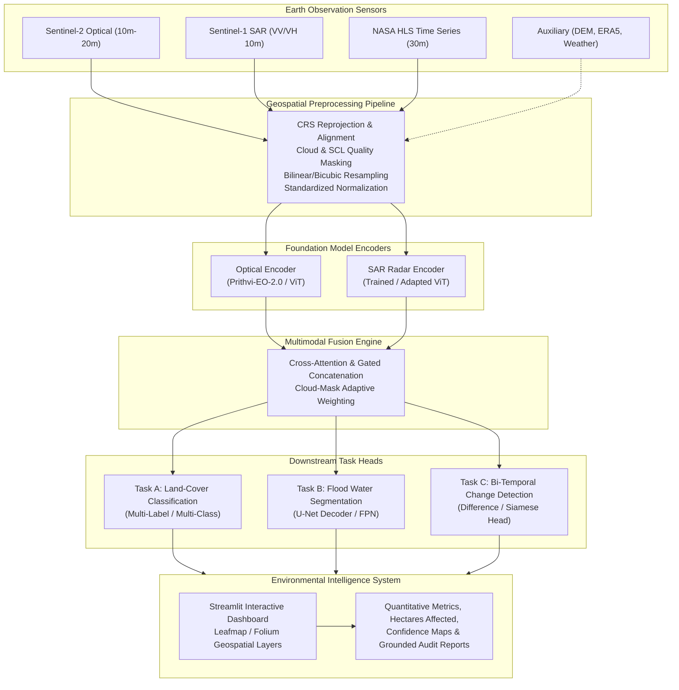

# 01. Project Overview & System Architecture

## 1. Executive Summary & Project Vision

The **Foundation Vision Models for Multimodal Remote Sensing and Environmental Intelligence** project bridges the gap between state-of-the-art Earth Observation (EO) Foundation Models and practical, operational environmental monitoring. 

Instead of training isolated, task-specific computer vision classifiers from scratch or relying solely on optical satellite imagery (which is easily degraded by clouds, smoke, and haze), this project leverages **pretrained Geospatial Vision Transformers (Geo-ViTs)**. We combine **multispectral optical imagery** (Sentinel-2, Landsat HLS), **Synthetic Aperture Radar (SAR)** (Sentinel-1), and **temporal observations** into a unified multimodal framework capable of delivering grounded environmental intelligence.

---

## 2. Core Research Objectives

1. **Learn General-Purpose Earth Representations:**
   * Evaluate the transferability of pretrained remote sensing backbones (specifically **Prithvi-EO-2.0 100M-TL**, **TerraMind**, and **Clay**) on unseen geographic regions without requiring massive pretraining compute from scratch.
2. **Perform Multimodal Optical-SAR Fusion:**
   * Formulate deep fusion mechanisms (feature concatenation, cross-attention, and sensor-confidence weighting) between optical reflectance (Sentinel-2/HLS) and microwave backscatter (Sentinel-1 $\text{VV}/\text{VH}$) to bridge sensor physics.
3. **Solve Crucial Downstream Environmental Tasks:**
   * **Task A (Land-Cover Classification):** Categorize diverse biomes, agricultural lands, water bodies, and urban sprawl.
   * **Task B (Flood Water Segmentation):** Delineate flood extents vs. permanent water under active storm/cloud conditions.
   * **Task C (Temporal Change Detection):** Track vegetation degradation, urban growth, and seasonal water shifts over multi-date observations.
4. **Deliver Evidence-Grounded Environmental Intelligence:**
   * Transition from abstract pixel predictions to quantitative hectares affected, georeferenced raster outputs (GeoTIFFs), uncertainty bounds, and factual, hallucinations-free analytical summaries.

---

## 3. Central Research Hypothesis

> **Primary Research Question:**
> *Does fusing pretrained optical foundation representations with Synthetic Aperture Radar (SAR) features provide statistically significant performance and calibration improvements for land-cover classification and flood segmentation under cloud-obscuration, sensor noise, and seasonal degradation compared to single-modality foundation baselines?*

### Why This Research Direction?
* **The Cloud Blindspot:** Optical sensors (Sentinel-2, Landsat) cannot penetrate cloud cover, haze, or volcanic smoke. In tropical and monsoon regions, cloud cover exceeds 70% during peak rainy and flood seasons—precisely when disaster response needs imagery most.
* **SAR Complementarity:** Sentinel-1 C-band Synthetic Aperture Radar operates day-and-night and penetrates clouds, responding directly to surface roughness and dielectric constants (water shows extreme specular low backscatter). However, SAR lacks spectral diagnostic capabilities for vegetation health and urban materials.
* **Scientific Value:** By evaluating models across a controlled cloud-degradation spectrum (simulated and real cloud masks), we measure the true resilience envelope of multimodal foundation models.

---

## 4. End-to-End System Workflow

### Stage 1: Data Ingestion & Storage
* Automated retrieval of multi-sensor tiles using STAC (SpatioTemporal Asset Catalog) APIs, Copernicus Data Space Ecosystem, and NASA Earthdata.
* Preservation of metadata: spatial bounding box, timestamp, Sun zenith/azimuth, orbit direction (ascending/descending), and sensor calibration coefficients.

### Stage 2: Geospatial Preprocessing (The Data Contract)
* Optical and SAR rasters reside in different Coordinate Reference Systems (CRS) and spatial resolutions ($10\text{m}$, $20\text{m}$, $60\text{m}$ for Sentinel-2 bands; $10\text{m}$ for Sentinel-1 GRD).
* Processing involves:
  * Reprojection to unified local UTM projections.
  * Spatial co-registration and cropping into fixed patch sizes (e.g., $224 \times 224$ or $256 \times 256$ pixels).
  * Cloud masking using Scene Classification Layer (SCL) or QA bands.
  * Band-stack ordering strictly aligned to foundation model pretraining conventions.

### Stage 3: Foundation Model Encoders
* Input patches pass through Vision Transformer backbones with patch-embedding projection layers.
* Spatial and temporal positional encodings are injected to capture spatial topology and acquisition seasons.

### Stage 4: Multimodal Fusion Engine
* Optical token representations ($Z_{\text{opt}} \in \mathbb{R}^{N \times D}$) and SAR token representations ($Z_{\text{sar}} \in \mathbb{R}^{N \times D}$) are combined:
  * **Level 1 (Concatenation):** Channel or embedding concatenation followed by a linear projection.
  * **Level 2 (Bidirectional Cross-Attention):** Optical tokens query SAR tokens and vice versa, enabling cross-modal feature enrichment.
  * **Level 3 (Gated Cloud Modulation):** Cloud probability scores dynamically modulate optical feature weight in favor of SAR.

### Stage 5: Task-Specific Prediction Heads
* **Classification Head:** Global Average Pooling + Multi-Layer Perceptron (MLP) for multi-label classification (e.g., BigEarthNet 19 classes).
* **Segmentation Head:** Feature Pyramid Network (FPN) or Lightweight U-Net Decoder taking multi-scale ViT intermediate features for pixel-wise flood segmentation (e.g., Sen1Floods11).
* **Change Head:** Feature subtraction/concatenation across timestamps $t_1$ and $t_2$ to generate change likelihood maps.

### Stage 6: Environmental Intelligence Dashboard
* Interactive web interface allowing researchers and environmental analysts to:
  * Select regions of interest (ROI) and historical time windows.
  * Toggle between true-color optical (RGB), false-color infrared (NIR-SWIR), SAR backscatter ($\text{VV}/\text{VH}$ ratio), and model prediction overlays.
  * Compute quantitative statistics: total square kilometers flooded, percentage forest loss, and prediction confidence distributions.
  * Export georeferenced GeoTIFFs compatible with QGIS and ArcGIS.

---

## 5. Potential Regional Case Study: Manipur & NE India

As an empirical demonstration, the system can be validated on real-world environmental events in North-East India (such as the Imphal Valley, Loktak Lake basin, and surrounding forested highlands):
1. **Flash Flooding & River Inundation:** Evaluating flood extent along the Imphal, Nambul, and Kongba rivers during heavy monsoon depressions, where optical Sentinel-2 is heavily cloud-obscured.
2. **Wetland & Floating Phumdis Monitoring:** Monitoring water surface dynamics and biomass variations across Loktak Lake using optical-SAR fusion.
3. **Forest Cover & Terrain Dynamics:** Distinguishing seasonal deciduous foliage shifts from permanent deforestation across steep topography using SAR backscatter combined with Copernicus DEM elevation context.
