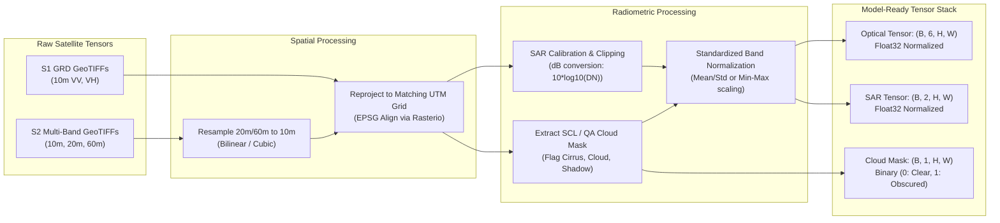

# 02. Datasets & Geospatial Data Engineering

## 1. Overview of Remote Sensing Datasets

Remote sensing data is inherently distinct from standard computer vision benchmarks (like ImageNet or COCO). Geospatial rasters carry:
* **Multi-modal physics:** Reflection of solar radiation (optical multispectral) vs. active microwave backscatter (radar SAR).
* **Varying spatial resolutions:** Spectral bands range from $10\text{m}$ to $60\text{m}$ ground sampling distance (GSD).
* **Coordinate Reference Systems (CRS):** Pixels tie to geographic and projected coordinates (e.g., EPSG:4326, UTM zones).
* **Dynamic range:** 12-bit to 16-bit integer digital numbers (DN) or surface reflectance floats ($[0.0, 1.0]$), rather than 8-bit $[0, 255]$ RGB.

---

## 2. Core Dataset Specifications

### 2.1 BigEarthNet v2.0 (Optical + Radar Land-Cover Benchmark)
* **Website:** [bigearth.net](https://bigearth.net/)
* **Size:** 549,488 co-registered Sentinel-1 and Sentinel-2 image patches across 10 European countries.
* **Modalities:**
  * **Sentinel-2 (Optical):** 12 multispectral bands (excluding Band 10). Resolution: $10\text{m}$ ($120 \times 120$ px), $20\text{m}$ ($60 \times 60$ px), $60\text{m}$ ($20 \times 20$ px).
  * **Sentinel-1 (SAR):** Level-1 Ground Range Detected (GRD) in dual-polarization: $\text{VV}$ and $\text{VH}$ at $10\text{m}$ resolution ($120 \times 120$ px).
* **Labels:** CORINE Land Cover (CLC) database mapped to 19 multi-label classes (recommended re-balanced scheme) or original 43 classes.
* **Role in Project:** Primary dataset for training and benchmarking multi-modal optical-SAR fusion for land-cover classification.

### 2.2 NASA Harmonized Landsat Sentinel-2 (HLS)
* **Website:** [NASA HLS](https://hls.gsfc.nasa.gov/) | [NASA Earthdata](https://search.earthdata.nasa.gov/)
* **Characteristics:** Combines Landsat 8/9 (L30) and Sentinel-2A/2B (S30) into a seamless 30m gridded Surface Reflectance product with a 2-to-3 day global revisit time.
* **Prithvi-EO-2.0 Native Band Configuration:**
  Prithvi foundation models natively expect a standardized 6-band input stack:
  1. **Blue** (B02 in S2 / B02 in Landsat 8)
  2. **Green** (B03 in S2 / B03 in Landsat 8)
  3. **Red** (B04 in S2 / B04 in Landsat 8)
  4. **Narrow NIR** (B8A in S2 / B05 in Landsat 8)
  5. **SWIR-1** (B11 in S2 / B06 in Landsat 8)
  6. **SWIR-2** (B12 in S2 / B07 in Landsat 8)
* **Role in Project:** Pretraining reference, temporal time-series representation learning, and domain adaptation.

### 2.3 Sen1Floods11 (SAR & Optical Flood Segmentation)
* **Paper / Code:** Bonafilia et al., CVPRW 2020.
* **Size:** 4,831 georeferenced chips ($512 \times 512$ pixels) spanning 11 historical flood events across 6 continents.
* **Modalities:**
  * Co-registered Sentinel-1 SAR ($\text{VV}$ and $\text{VH}$).
  * Sentinel-2 optical imagery (available for cloud-free or partially cloud-covered subsets).
* **Ground Truth Annotations:**
  * Hand-labeled verification subset (446 chips) with pixel-level ground truth: `0: No Water`, `1: Permanent Water`, `2: Flood Water`, `-1: Invalid/Cloud`.
  * Weakly-labeled subset (4,385 chips) generated via automated thresholds.
* **Role in Project:** Primary benchmark for pixel-level flood segmentation under clear vs. cloud-obscured conditions.

### 2.4 Functional Map of the World (fMoW)
* **Repository:** [fMoW GitHub](https://github.com/fMoW/dataset)
* **Size:** 62 facility and infrastructure categories. Full multispectral $\sim 3.5\text{ TB}$; RGB-only $\sim 200\text{ GB}$.
* **Role in Project:** High-resolution geospatial scene classification and spatial generalization baseline.

### 2.5 SpaceNet 7 (Multi-Temporal Urban Development)
* **Website:** [spacenet.ai/sn7-challenge](https://www.spacenet.ai/sn7-challenge/)
* **Characteristics:** Monthly satellite image sequences ($4\text{m}$ imagery) over 100+ geographical areas over two years with building footprint polygon labels.
* **Role in Project:** Primary dataset for temporal change detection and urban growth tracking.

### 2.6 BigEarthNet.txt (Vision-Language Remote Sensing)
* **Website:** [txt.bigearth.net](https://txt.bigearth.net/)
* **Characteristics:** Released in 2026; adds 9.6 million rich text descriptions to 464,044 BigEarthNet S1/S2 pairs.
* **Role in Project:** Optional grounding for visual question answering (VQA), semantic captioning, and language-guided retrieval.

---

## 3. Auxiliary Datasets for Environmental Intelligence

| Dataset | Modality / Sensor | Resolution | Application | Priority |
| :--- | :--- | :--- | :--- | :--- |
| **EuroSAT** | Sentinel-2 (13 bands) | 10m | Rapid benchmarking for Land Use / Land Cover (LULC) | High |
| **ESA WorldCover** | S1 + S2 classification map | 10m | Global independent reference baseline (11 classes) | High |
| **Dynamic World** | Near real-time S2 LULC | 10m | High-frequency continuous land-cover probability maps | High |
| **Copernicus DEM** | Digital Elevation Model (GLO-30) | 30m | Terrain elevation, slope, aspect for flood inundation modeling | Medium |
| **ERA5-Land** | Atmospheric reanalysis | 9km | Surface temperature, soil moisture, wind speed | Medium |
| **CHIRPS** | Satellite + station rainfall | 0.05° (~5km) | Daily precipitation records for antecedent flood modeling | Medium |
| **GEDI** | Spaceborne Lidar | 25m footprint | Canopy top height and aboveground biomass density | Medium |

> [!WARNING]
> **Data Quality Caveat:** Products like *Dynamic World* and *ESA WorldCover* are model-derived predictions, not manual ground truth. When measuring accuracy, treat them as comparative baselines or weak supervisory signals, never as error-free truth.

---

## 4. Geospatial Preprocessing Pipeline

Remote sensing data requires careful spatial and radiometric preparation before feeding into Vision Transformers.

### 4.1 Multispectral Band Alignment & Resampling
1. **Sentinel-2 Band Resolutions:**
   * $10\text{m}$: B02 (Blue), B03 (Green), B04 (Red), B08 (NIR).
   * $20\text{m}$: B05, B06, B07 (Red Edge), B8A (Narrow NIR), B11 (SWIR-1), B12 (SWIR-2).
   * $60\text{m}$: B01 (Coastal Aerosol), B09 (Water Vapour).
2. **Resampling Protocol:**
   * Resample all $20\text{m}$ bands (specifically B8A, B11, B12 required for Prithvi) to $10\text{m}$ matching the spatial grid using **Bilinear** or **Bicubic** interpolation.
   * Segmentation masks and discrete labels must **always** be resampled using **Nearest Neighbor** to avoid interpolating categorical class IDs.

### 4.2 Sentinel-1 SAR Calibration & Speckle Filtering
1. **Linear DN to Decibel (dB) Conversion:**
   $$ \sigma^0_{\text{dB}} = 10 \cdot \log_{10}(\text{DN}^2 + \epsilon) $$
2. **Value Clipping & Normalization:**
   * Raw SAR dB values typically range from $-35\text{ dB}$ (calm water specular reflection) to $0\text{ dB}$ (dense urban corner reflectors).
   * Standard practice: Clip $\text{VV} \in [-30.0, 0.0]\text{ dB}$ and $\text{VH} \in [-35.0, -5.0]\text{ dB}$, then normalize linearly to $[0.0, 1.0]$ or standardize with dataset mean and standard deviation:
     $$ x_{\text{norm}} = \frac{x - \mu}{\sigma} $$

### 4.3 Cloud Masking & Scene Classification
* Use the Sentinel-2 **Scene Classification Layer (SCL)** band:
  * Class 3: Cloud Shadows
  * Class 8: Cloud Medium Probability
  * Class 9: Cloud High Probability
  * Class 10: Thin Cirrus
* Create a binary cloud mask $M_{\text{cloud}} \in \{0, 1\}^{H \times W}$ where $1$ denotes invalid/cloud-obscured pixels. This mask is essential for:
  1. Evaluating model resilience under varying cloud percentages.
  2. Guiding the multimodal fusion cross-attention gate to downweight corrupted optical channels.

---

## 5. Preventing Spatial Data Leakage

> [!CAUTION]
> **Spatial Autocorrelation Hazard:**
> Satellite scenes possess high spatial correlation. If adjacent $256 \times 256$ patches cut from the same satellite pass are randomly assigned to train and test splits, the test score will be artificially inflated (spatial memorization).

### The Spatial Blocking Protocol:
1. **Never use random shuffle splitting.**
2. Partition data using **Geographic Blocks / Spatial Tiles**:
   * Group patches by their Sentinel-2 MGRS tile ID (e.g., `32UMU`, `33TUN`) or geographic bounding box clusters.
   * Assign complete geographic regions exclusively to **Train**, **Validation**, or **Test**.
3. **Cross-Region Evaluation Split:**
   * Reserve at least one geographically distinct biome or country solely for zero-shot / out-of-distribution evaluation (e.g., train on Central Europe, evaluate on Southern Europe or South Asia).
