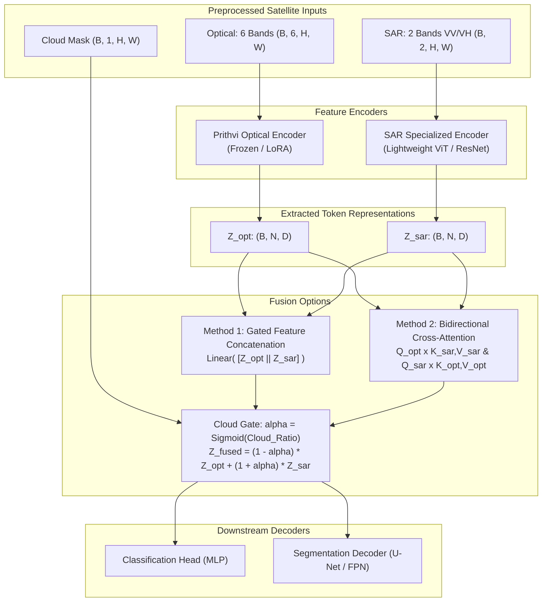

# 03. Foundation Models & Multimodal Fusion Architectures

## 1. Earth Observation Foundation Models Overview

Instead of training a Vision Transformer (ViT) from random initialization (which requires millions of labeled samples), Earth Observation (EO) foundation models leverage **Self-Supervised Learning (SSL)**—primarily Masked Autoencoding (MAE)—on petabytes of unlabeled satellite tiles.

---

## 2. Model Zoo & Candidates

### 2.1 Prithvi-EO-2.0 (Recommended Primary Backbone)
* **Developed by:** NASA & IBM Research (available on [Hugging Face](https://huggingface.co/ibm-nasa-geospatial/Prithvi-EO-2.0-100M-TL)).
* **Architecture:** Geospatial Vision Transformer based on 3D-MAE (Masked Autoencoder over spatial and temporal dimensions).
* **Pretraining Data:** Harmonized Landsat Sentinel-2 (HLS) multi-temporal surface reflectance imagery.
* **Checkpoint Hierarchy:**
  * `Prithvi-EO-2.0-100M-TL`: 100 Million parameters (TL: Temporal + Location). **Recommended baseline for our 6 GB VRAM constraint.**
  * `Prithvi-EO-2.0-300M`: 300 Million parameters (Higher capacity, requires cloud GPU cluster).
* **Native Input Format:**
  * Shape: `(Batch, Channels=6, Time_steps=T, Height, Width)`
  * Patch Size: $16 \times 16$ pixels.
  * Native 6 Bands: Blue, Green, Red, Narrow NIR, SWIR-1, SWIR-2.
  * Location: Embeds acquisition latitude/longitude coordinates and acquisition date (day of year).

### 2.2 TerraMind (Multimodal Comparison)
* **Developed by:** European Space Agency (ESA) & IBM Research.
* **Architecture:** Native multimodal Earth Observation foundation model trained to jointly represent optical, SAR (Sentinel-1), elevation (Copernicus DEM), and land cover.
* **Role in Project:** Ideal comparative benchmark for native multimodal representations vs. our modular fusion pipeline.

### 2.3 Clay Foundation Model
* **Developed by:** Clay Foundation ([GitHub](https://github.com/Clay-foundation/model)).
* **Architecture:** ViT with masked autoencoding conditioned on coordinate locations and acquisition timestamps.
* **Role in Project:** Alternative backbone for zero-shot representation learning and linear probing.

### 2.4 Classical Baselines
* **ResNet-50 / ConvNeXt-Tiny:** Classical CNN baseline trained on the same data split.
* **ViT-Small (from scratch):** Demonstrates the performance gain provided by domain-specific satellite pretraining over random initialization.

---

## 3. Multimodal Fusion Architectures

How do we fuse Optical ($X_{\text{opt}} \in \mathbb{R}^{B \times 6 \times H \times W}$) and SAR ($X_{\text{sar}} \in \mathbb{R}^{B \times 2 \times H \times W}$)?



### 3.1 Method 1: Feature Concatenation (Baseline Fusion)
Tokens from both encoders are concatenated along the feature dimension and projected back to the hidden size $D$:
$$ Z_{\text{fused}} = \text{LayerNorm}\left( W_f [ Z_{\text{opt}} \parallel Z_{\text{sar}} ] + b_f \right) $$
* **Pros:** Computationally minimal, straightforward to backpropagate, low memory footprint.
* **Cons:** Lacks dynamic attention to query radar features when optical features are noisy.

### 3.2 Method 2: Bidirectional Cross-Attention Fusion
Optical tokens act as Queries ($Q_{\text{opt}} = Z_{\text{opt}} W_Q$) while SAR tokens act as Keys and Values ($K_{\text{sar}} = Z_{\text{sar}} W_K, V_{\text{sar}} = Z_{\text{sar}} W_V$):
$$ \text{Attention}(Q_{\text{opt}}, K_{\text{sar}}, V_{\text{sar}}) = \text{Softmax}\left(\frac{Q_{\text{opt}} K_{\text{sar}}^T}{\sqrt{d_k}}\right) V_{\text{sar}} $$
Concurrently, SAR tokens query optical tokens:
$$ \text{Attention}(Q_{\text{sar}}, K_{\text{opt}}, V_{\text{opt}}) = \text{Softmax}\left(\frac{Q_{\text{sar}} K_{\text{opt}}^T}{\sqrt{d_k}}\right) V_{\text{opt}} $$
The outputs are combined with residual connections, allowing the network to explicitly transfer structural radar edges into cloud-degraded optical regions.

### 3.3 Method 3: Cloud-Adaptive Gated Modulation
Using the average cloud probability $\alpha = \frac{1}{HW}\sum_{i,j} M_{\text{cloud}}(i,j) \in [0.0, 1.0]$:
$$ Z_{\text{fused}} = (1 - \alpha) \cdot Z_{\text{opt}} + (1 + \alpha) \cdot Z_{\text{sar}} $$
This explicitly prevents gradient corruption from heavily cloud-obscured optical scenes.

---

## 4. Hardware Optimization for 6 GB VRAM (NVIDIA RTX 2060)

Running Vision Transformers on remote sensing tensors with 6 GB of VRAM requires strict memory discipline:

### Strategy 1: Frozen Encoder + Head Tuning (Level 1)
* Keep the Prithvi foundation backbone completely frozen (`for p in model.encoder.parameters(): p.requires_grad = False`).
* Only train the lightweight MLP head (classification) or lightweight FPN decoder (segmentation).
* **VRAM Impact:** Reduces training memory by up to 75%.

### Strategy 2: Pre-Computing and Disk Caching Embeddings
* For frozen backbones, run a single forward pass over all dataset chips and save the extracted token embeddings (`.pt` or `.h5` files) to disk.
* Training the downstream classifier reads pre-computed embeddings directly, consuming **under 1 GB VRAM** and speeding up epoch times by $10\times$.

### Strategy 3: Mixed Precision & Gradient Accumulation
```python
import torch
from torch.cuda.amp import autocast, GradScaler

scaler = GradScaler()
accumulation_steps = 4  # Simulates batch_size = 4 * 8 = 32

for i, (images_opt, images_sar, labels) in enumerate(dataloader):
    with autocast(dtype=torch.float16):
        outputs = model(images_opt, images_sar)
        loss = criterion(outputs, labels) / accumulation_steps

    scaler.scale(loss).backward()

    if (i + 1) % accumulation_steps == 0:
        scaler.step(optimizer)
        scaler.update()
        optimizer.zero_grad()
```

### Strategy 4: Gradient Checkpointing
* When fine-tuning selected transformer blocks (`requires_grad=True`), enable gradient checkpointing:
  ```python
  model.gradient_checkpointing_enable()
  ```
* Recomputes activations during backward pass instead of storing them, trading $\sim 20\%$ compute time for $\sim 50\%$ VRAM reduction.

### Strategy 5: Patch Sizing
* Standardize on patch sizes of $224 \times 224$ or $256 \times 256$ pixels.
* Avoid full $512 \times 512$ or $1024 \times 1024$ scenes in a single forward pass; use a sliding window with $50\%$ overlap during inference.
