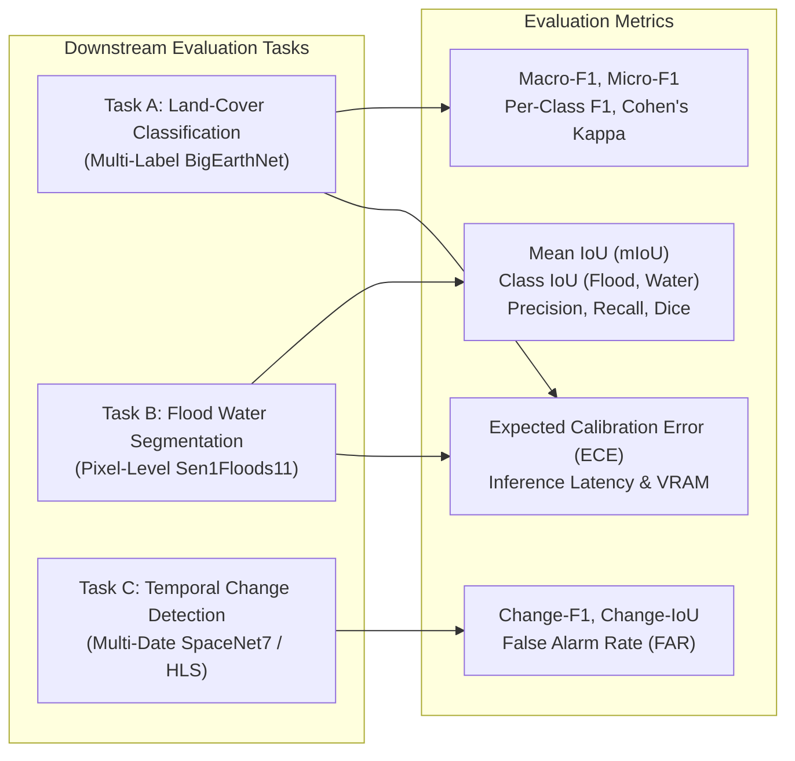

# 04. Training Strategy, Experiments & Evaluation Protocol

## 1. Three-Level Development Strategy

| Level | Model Scope | Primary Objective | Compute / VRAM | Feasibility |
| :--- | :--- | :--- | :--- | :--- |
| **Level 1** | **Frozen Foundation Model** | Linear probing & feature extraction. Evaluate baseline representation power. | Minimal (< 2 GB) | **Immediate Priority** |
| **Level 2** | **Multimodal Fusion & Fine-Tuning** | Adapting Prithvi with SAR fusion module. LoRA / partial block fine-tuning. | Moderate (4–6 GB) | **Core Project Deliverable** |
| **Level 3** | **Pretrain Foundation Model from Scratch** | Full self-supervised pretraining on millions of unlabeled tiles. | Massive (> 80 GB clusters) | *Out of Scope (Impractical for student setup)* |

---

## 2. Controlled Experiment Matrix (E1 – E6)

Every experiment must use the identical geographic train/val/test splits, loss functions, and evaluation metrics to ensure scientific defensibility.

| Exp ID | Model Architecture | Modality Inputs | Research Hypothesis / Benchmark Tested |
| :--- | :--- | :--- | :--- |
| **E1** | ResNet-50 / ConvNeXt-Tiny | Optical only (6 bands) | Conventional non-foundation vision baseline. |
| **E2** | Frozen Prithvi-EO-2.0 + Head | Optical only (6 bands) | Transferability of unadapted foundation representations. |
| **E3** | Fine-tuned Prithvi-EO-2.0 | Optical only (6 bands) | Benefit of domain-specific target task fine-tuning. |
| **E4** | Dual Encoder + Fusion Module | Optical (6 bands) + SAR (2 bands) | **Primary Research Hypothesis:** Does optical-SAR fusion outperform optical alone? |
| **E5** | Spatio-Temporal Prithvi + Fusion | Optical + SAR over $T=3$ dates | Benefit of multi-temporal sequences for seasonal & change tasks. |
| **E6** | Best Model from E4/E5 | Optical + SAR (Unseen regions) | Spatial generalization out-of-distribution (e.g., European model evaluated on South Asia). |

---

## 3. Downstream Tasks & Metrics



### 3.1 Task A: Land-Cover Classification (Multi-Label)
* **Primary Metrics:**
  * **Macro-F1 Score:**
    $$ \text{Macro-F1} = \frac{1}{K} \sum_{k=1}^K F1_k $$
    Crucial for remote sensing where rare classes (e.g., Peatbogs, Burnt areas) have few samples compared to common classes (Coniferous forest, Arable land).
  * **Per-Class F1 & Precision-Recall Curves:** To identify which land-cover categories benefit most from SAR backscatter (e.g., distinguishing urban concrete vs. barren soil).

### 3.2 Task B: Flood Water Segmentation (Pixel-Wise)
* **Primary Metrics:**
  * **Intersection-over-Union (IoU / Jaccard Index):**
    $$ \text{IoU}_c = \frac{TP_c}{TP_c + FP_c + FN_c} $$
  * **Mean IoU ($\text{mIoU}$):** Computed over three classes: `Permanent Water`, `Flood Water`, `Non-Water`.
  * **Recall on Flood Water:** In disaster intelligence, missing flooded settlements (False Negatives) is more catastrophic than over-predicting water (False Positives).

### 3.3 Task C: Temporal Change Detection
* **Primary Metrics:** Change-F1, Change-IoU, and Detection False Alarm Rate (FAR).

### 3.4 Operational & Reliability Metrics
* **Expected Calibration Error (ECE):** Evaluates if model confidence matches empirical probability.
* **Inference Latency (ms/chip):** Benchmarked on local RTX 2060 GPU and CPU.
* **Peak Memory Footprint (VRAM in MB).**

---

## 4. Key Scientific Ablation Studies

To turn this into a publishable research paper, the team must execute these controlled ablations:

### 4.1 Modality Importance Ablation
Compare on the exact same test set:
1. Optical Only (Sentinel-2 / HLS)
2. Radar Only (Sentinel-1 SAR $\text{VV} + \text{VH}$)
3. Optical + Radar Fused (Proposed)

### 4.2 The Cloud-Robustness Stress Test (Core Contribution)
Simulate increasing cloud cover on the clean test set to test resilience:
* **Test Conditions:**
  * $0\%$ cloud cover (Clean optical baseline).
  * $25\%$ cloud cover (Partial cloud masks applied).
  * $50\%$ cloud cover.
  * $75\%$ cloud cover.
  * $100\%$ cloud cover (Complete optical dropout—SAR only).

```
Expected Scientific Finding:
Optical-only models will experience catastrophic degradation as cloud cover approaches 100%.
The Multimodal Fusion model will remain resilient by adaptively relying on SAR backscatter.
```

### 4.3 Fusion Strategy Ablation
* Concatenation Fusion vs. Cross-Attention Fusion vs. Cloud-Gated Modulation.
* Compare parameter overhead, training stability, and mIoU gains.
