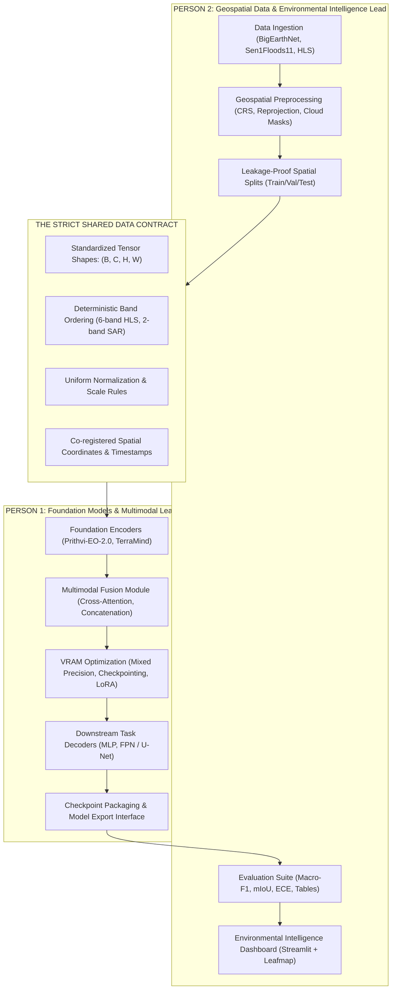

# 05. Team Division & Operational Contracts

## 1. Role Division: 2-Person Research Team

To execute this project with clear ownership and zero friction, responsibilities are split cleanly into two complementary workstreams:



---

## 2. Person 1: Foundation Models & Multimodal Learning Lead

### Primary Responsibilities:
1. **Foundation Model Research & Adaptation:**
   * Integrate pretrained weights for **Prithvi-EO-2.0 100M-TL** and explore TerraMind/Clay.
   * Implement token projection layers and positional encodings.
2. **Multimodal Fusion Architectures:**
   * Build modular fusion layers in PyTorch:
     * `GatedConcatFusion`
     * `BidirectionalCrossAttentionFusion`
     * `CloudAdaptiveGate`
3. **Hardware & Memory Optimization:**
   * Guarantee all models run efficiently within local **6 GB VRAM (RTX 2060)** using PyTorch AMP FP16, gradient accumulation, and gradient checkpointing.
   * Build embedding extraction and disk caching scripts for frozen foundation runs.
4. **Model Delivery & Interface:**
   * Provide a clean, documented Python inference API:
     ```python
     def predict(optical_tensor: torch.Tensor, 
                 sar_tensor: torch.Tensor, 
                 cloud_mask: torch.Tensor = None) -> dict:
         """Returns prediction logits, softmax probabilities, and uncertainty."""
     ```

---

## 3. Person 2: Geospatial Data & Environmental Intelligence Lead

### Primary Responsibilities:
1. **Data Acquisition & Curation:**
   * Download and verify subsets of **BigEarthNet v2.0** and **Sen1Floods11**.
   * Retrieve sample HLS time series and Copernicus DEM auxiliary data.
2. **Geospatial Preprocessing Pipeline:**
   * Convert heterogeneous GeoTIFFs into uniform arrays using `Rasterio` and `TorchGeo`.
   * Implement SCL-based cloud masks and Sentinel-1 decibel calibration.
3. **Leakage-Proof Geographic Partitioning:**
   * Partition data into non-overlapping spatial blocks / MGRS tiles to prevent spatial autocorrelation leakage.
4. **Evaluation & Verification Suite:**
   * Build automated evaluation scripts computing Macro-F1, per-class F1, mIoU, and confusion matrices.
   * Implement the synthetic cloud corruption stress-test (0% to 100% cloud dropout).
5. **Interactive Environmental Dashboard:**
   * Develop a **Streamlit** dashboard integrating `Leafmap` or `Folium` to display:
     * Satellite basemaps (True Color RGB, False Color NIR, SAR $\text{VV}/\text{VH}$).
     * Model flood and land-cover segmentation overlays.
     * Summary cards (total hectares inundated, confidence score distributions).

---

## 4. The Shared Data Contract (Critical Interface)

To prevent mismatch between data preprocessing and model architecture, both members adhere strictly to the following specification:

### 4.1 Optical Tensor Specifications
* **Tensor Shape:** `(Batch, 6, Height=224, Width=224)` of type `torch.float32`.
* **Channel Ordering (Strict Prithvi convention):**
  * Index `0`: **Blue** (Sentinel-2 B02)
  * Index `1`: **Green** (Sentinel-2 B03)
  * Index `2`: **Red** (Sentinel-2 B04)
  * Index `3`: **Narrow NIR** (Sentinel-2 B8A, resampled from 20m to 10m)
  * Index `4`: **SWIR-1** (Sentinel-2 B11, resampled from 20m to 10m)
  * Index `5`: **SWIR-2** (Sentinel-2 B12, resampled from 20m to 10m)
* **Normalization:** Surface Reflectance normalized to $[0.0, 1.0]$ or standard scaled using Prithvi channel means and standard deviations:
  * Means $\mu = [0.0838, 0.1169, 0.1039, 0.2831, 0.2078, 0.1384]$
  * Stds $\sigma = [0.0465, 0.0538, 0.0655, 0.0935, 0.0886, 0.0763]$

### 4.2 SAR (Radar) Tensor Specifications
* **Tensor Shape:** `(Batch, 2, Height=224, Width=224)` of type `torch.float32`.
* **Channel Ordering:**
  * Index `0`: **$\text{VV}$ Backscatter** (Decibels, clipped to $[-30.0, 0.0]$)
  * Index `1`: **$\text{VH}$ Backscatter** (Decibels, clipped to $[-35.0, -5.0]$)
* **Normalization:** Linearly mapped to $[0.0, 1.0]$ via $x_{\text{scaled}} = \frac{x - \text{min}}{\text{max} - \text{min}}$.

### 4.3 Cloud Mask Specifications
* **Tensor Shape:** `(Batch, 1, Height=224, Width=224)` of type `torch.float32`.
* **Values:** `0.0` indicates clear sky; `1.0` indicates cloud, haze, or cloud shadow.

### 4.4 Target Labels
* **Classification (BigEarthNet):** `(Batch, 19)` multi-hot binary vector of type `torch.float32`.
* **Segmentation (Sen1Floods11):** `(Batch, Height=224, Width=224)` of type `torch.int64`:
  * `0`: Non-water
  * `1`: Permanent water
  * `2`: Flood water
  * `-1`: Ignore / invalid index

---

## 5. 8-Week Collaborative Research Schedule

| Week | Person 1 (Models & Fusion) | Person 2 (Data & Applications) | Joint Milestone |
| :---: | :--- | :--- | :--- |
| **W1** | Set up PyTorch, TerraTorch; inspect Prithvi model card & weights. | Set up Rasterio, TorchGeo; obtain BigEarthNet & Sen1Floods11 samples. | Architecture & Data Contract confirmed. |
| **W2** | Build optical encoder wrapper; test forward pass on dummy tensor. | Build data ingestion & reprojection pipeline for S1/S2 pairs. | End-to-end forward pass on raw satellite sample. |
| **W3** | Implement Level 1 frozen Prithvi baseline + MLP classification head. | Build spatial blocking splits (Train/Val/Test) preventing spatial leakage. | **E1 (ResNet) & E2 (Frozen Prithvi) trained.** |
| **W4** | Implement Feature Concatenation & Cross-Attention fusion modules. | Finalize Sen1Floods11 segmentation masks and data loaders. | Multimodal pipeline operational. |
| **W5** | Train Multimodal Fusion Model on BigEarthNet & Sen1Floods11 (E4). | Implement Macro-F1, mIoU, and calibration metric scripts. | **E4 (Multimodal Model) preliminary results.** |
| **W6** | Optimize fine-tuning with mixed precision & gradient accumulation. | Implement cloud-degradation stress test (0% to 100% cloud obscuration). | Cloud-robustness hypothesis evaluated. |
| **W7** | Run comparative ablations (Optical vs SAR vs Fused); export models. | Build interactive Streamlit environmental dashboard with map layers. | Full prototype integrated with live dashboard. |
| **W8** | Finalize experimental charts, latency tables, and model documentation. | Finalize geographic case study visualizations and demo deployment. | **Final Research Report & Codebase Complete.** |
